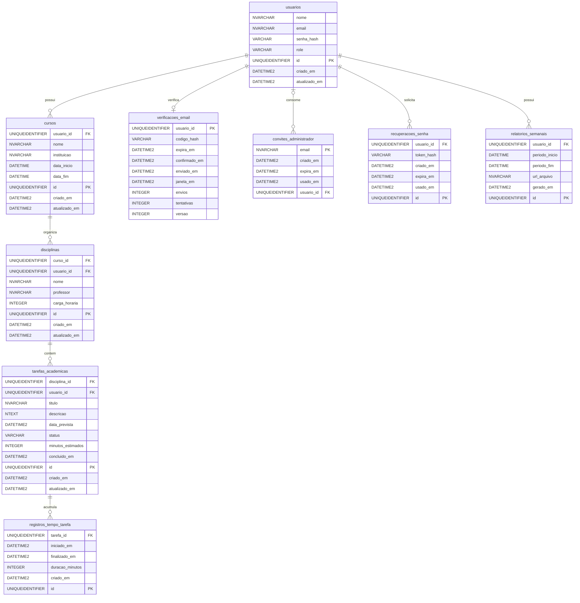

# Modelo de dados (DER)

Cardinalidades e vínculos do modelo alvo. O diagrama não contém dados dos alunos.

Curso e disciplina também possuem FK para usuarios. As FK compostas de organização acadêmica preservam a titularidade. Uma confirmação de e-mail pertence a uma única conta; um convite pode estar pendente, sem conta vinculada.
